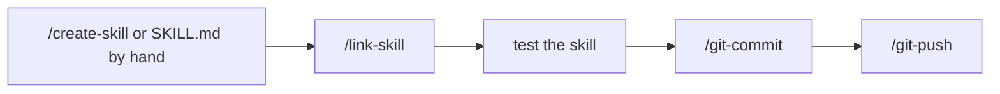

# Adding a skill

How to add a new Claude Code skill to this repository and install it, for anyone working on these skills.

## Overview



## 1. Create the skill

### With `/create-skill` (recommended)

Describe what the skill should do after the command:

```
/create-skill a skill that lists the TODO comments of the project and suggests which one to handle first
```

It asks about anything unclear, picks the category folder (or proposes a new one and waits for your choice), checks that the name isn't already taken, writes the `SKILL.md` following the repository's conventions, then installs it with `/link-skill`.

### By hand

Create `skills/<category>/<name>/SKILL.md`. The existing categories are `git`, `quality`, `docs`, `study` and `tools`.

- Name it in English kebab-case, with the category prefix when it has one (`git-` for git skills). It must be unique across all categories, because the links in `~/.claude/skills` are flat.
- Check that the name isn't a built-in command such as `/branch`, `/commit` or `/pr`: a skill with the same name replaces it.
- Start the file with the frontmatter (`name`, `description`, `argument-hint`, `allowed-tools`), then write the instructions. Step 3 of `skills/tools/create-skill/SKILL.md` lists the repository's conventions.

## 2. Install it

```
/link-skill
```

It runs `skills/tools/link-skill/scripts/link.sh`, which links every folder containing a `SKILL.md` into `~/.claude/skills/` and prints one line per skill:

| Output | Meaning |
|---|---|
| `linked` | a new link was created |
| `ok` | the skill was already linked |
| `removed` | the link pointed to a skill that was renamed, moved or deleted |
| `skipped` | something else already has that name in `~/.claude/skills` |

The new skill shows up in the `/` menu a few seconds later, or right away after `/reload-skills`.

Editing an existing skill needs no new link: the link points to the skill's folder, so the new version is used directly.

## 3. Test it

Type `/<name>` with a realistic request and check the result. Then make the same request in your own words, without the command, to check that the description is enough for Claude to pick the skill.

## 4. Commit it

```
/git-commit
```

It makes one commit per intent, for example `feat(<name>): add <name> skill`, then offers to push with `/git-push`.
