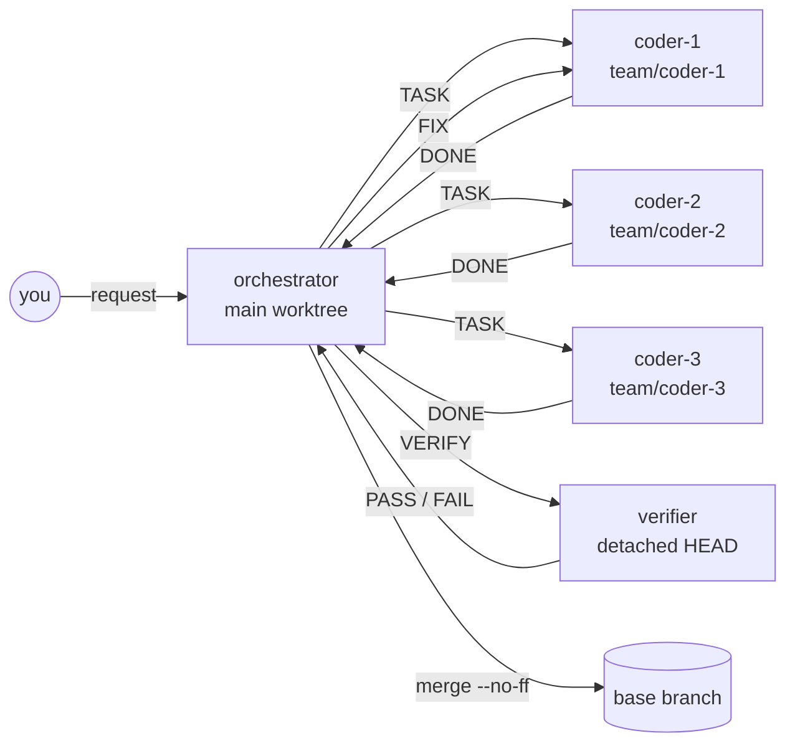

# Team workflow

`claude-team` runs a small team of Claude Code sessions on one project: an **orchestrator** you talk to, **coders** that work in parallel (3 by default), and a **verifier** that checks each coder's work before it is merged. Each member is a normal interactive Claude Code session in its own tmux pane and its own git worktree; they talk to each other with SendMessage.

## Overview



1. You give the orchestrator a request.
2. It explores the code, splits the work into independent tasks (separate files) and sends one `TASK` to each coder it needs.
3. Each coder syncs its branch with the base branch, implements, runs the project's checks, commits and reports `DONE`.
4. The orchestrator sends each finished branch to the verifier, which reviews the diff, runs the checks and reports `PASS` or `FAIL` with the problems found.
5. On `FAIL`, the orchestrator sends the problems back to the coder (`FIX`). On `PASS`, it merges the branch into the base branch.
6. When everything is merged, the verifier checks the whole result once more (`VERIFY FINAL`) and the orchestrator reports to you.

Nothing is pushed unless you ask the orchestrator to.

## Install

Once, from this repository:

```bash
team/claude-team install
```

It links the script into `~/.local/bin/claude-team`. Editing the script or the roles in this repository takes effect at the next `claude-team start`, without reinstalling.

Requirements: `git`, `tmux` (3.1 or later), `claude`, and `python3` for the session list of `claude-team status` and the trust check.

## Use

From the main folder of any git repository, on the branch the team should work from:

```bash
claude-team                 # start the team (or reopen it if it is running)
claude-team --coders 2      # start with 2 coders instead of 3
claude-team attach          # reopen the running team after a detach
claude-team status          # sessions, branches and the orchestrator's board
claude-team stop            # close the sessions; worktrees and branches stay
claude-team clean           # delete the worktrees, team/* branches and state
```

The tmux window looks like this:

```
┌──────────────┬──────────────┐
│ orchestrator │ coder-1      │
│              ├──────────────┤
│              │ coder-2      │
├──────────────┤──────────────┤
│ verifier     │ coder-3      │
└──────────────┴──────────────┘
```

- Type your request in the **orchestrator** pane. Click another pane to watch a member or talk to it directly.
- `Ctrl-b d` detaches; the sessions keep running. `claude-team attach` brings you back.
- If a member's session ends, its pane prints the command that relaunches it.

The first time you use the team in a project, Claude Code asks every pane whether you trust the folder. Run `claude` once in the project and accept beforehand to answer only once: the worktrees inside the project inherit that trust.

## Settings

| Variable | Default | Effect |
|---|---|---|
| `CLAUDE_TEAM_MODEL` | `opus` | model of every member (`sonnet`, `haiku`, a full model id...) |
| `CLAUDE_TEAM_CODERS` | `3` | number of coders, from 1 to 9 (same as `--coders`) |

Every member runs in auto mode. They must all share one permission mode: a session holds messages coming from a session in another mode until its user approves them, which would stall the team.

Five sessions draw on your usage limits about five times as fast as one. Use `CLAUDE_TEAM_MODEL=sonnet` or fewer coders for routine work.

## Where things live

| What | Where |
|---|---|
| Role instructions | `team/roles/orchestrator.md`, `coder.md`, `verifier.md` in this repository |
| Coder worktrees | `<project>/.claude/worktrees/team-coder-N`, on branch `team/coder-N` |
| Verifier worktree | `<project>/.claude/worktrees/team-verifier`, detached HEAD |
| Generated prompts, launchers, board | `<project>/.git/claude-team/` |

The script adds `.claude/worktrees/` to the project's `.git/info/exclude`, so the worktrees never show up in `git status`. Tools that scan every subfolder (such as `norminette` run without arguments in the main folder) do see them: pass the folders to check explicitly, or let the verifier run the checks in its own worktree.

Each session gets the role file plus a "Team" section (names, folders, branches, base branch, board file) through `--append-system-prompt`, on top of Claude Code's default system prompt. Session names are `<project>-orchestrator`, `<project>-coder-N` and `<project>-verifier`, so teams of different projects can run at the same time.

## Change the workflow

- **A role's behavior**: edit its file in `team/roles/`, then `claude-team stop` and `claude-team start`.
- **The merge rule**: the orchestrator merges with `git merge --no-ff` and never squashes, because coders fast-forward their branch onto the base branch before each task. Keep that pair consistent if you change it.
- **A new role** (a doc writer, a tester...): add `team/roles/<role>.md`, then add it to `write_roster`, the `write_member` calls and `open_tmux` in `team/claude-team`.
